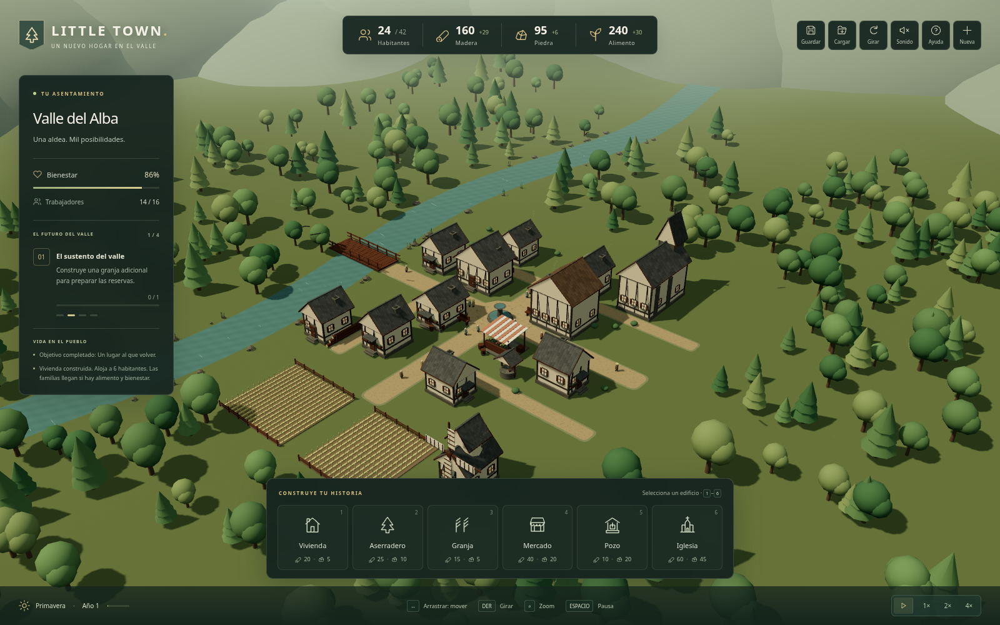
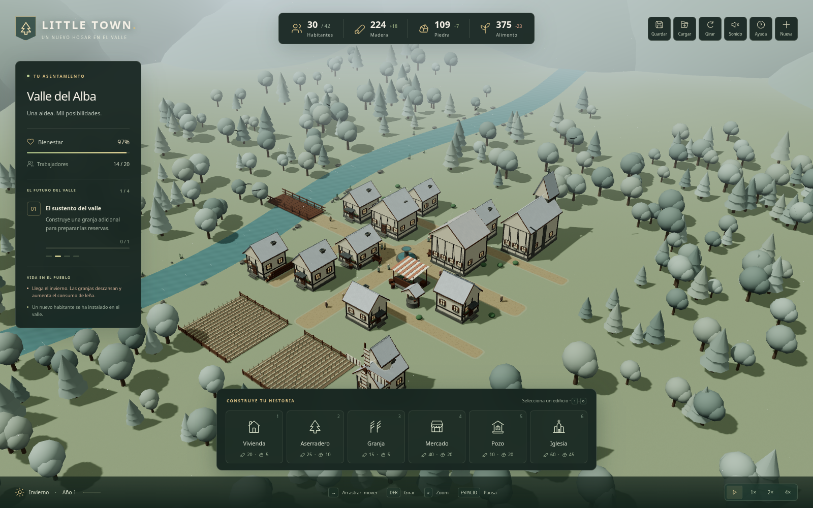
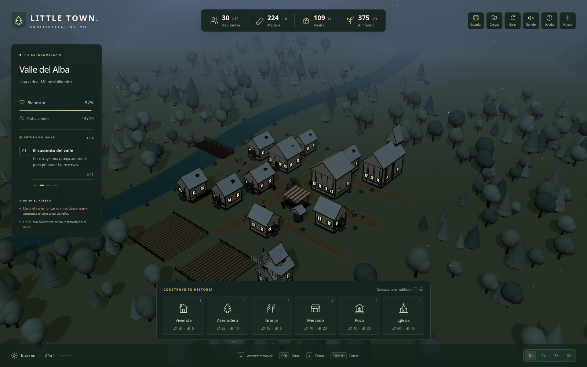

# Revisión visual independiente · 0.2

Capturas reales de Chromium a 1600 × 1000, con renderizado por software.
Se revisaron también móvil a 390 × 844 y el diálogo de ayuda.

## Defectos corregidos durante las revisiones

- Intersecciones de árboles con campos y edificios iniciales.
- Parpadeo y moteado negro en las cubiertas nevadas.
- Finales rectangulares bruscos de los caminos y escasa separación de materiales.
- Controles que no coincidían con su comportamiento y textos de aforo incorrectos.
- Indicaciones antiguas de estación en las capturas de prueba: ahora se espera
  el estado visible actualizado antes de capturar.
- La prueba móvil espera a que el canvas termine el cambio real de tamaño antes
  de comprobar la ausencia de desbordamiento.

## Evaluación final

No se observaron bloqueos visuales graves en día, invierno, noche o móvil.
La interfaz deja libre el centro del escenario y permite consultar objetivos,
empleo, producción y eventos. Las ventanas cálidas distinguen la noche.

La vegetación y las colinas siguen siendo facetadas; hay repetición de edificios,
poco detalle de suelo y agua simplificada. Por tanto, esta revisión **no acredita
calidad AAA ni paridad con Cities: Skylines**. Tampoco fue una comparación a ciegas:
no había capturas de referencia equivalentes. Son límites de la versión, no
resultados que deban ocultarse con una puntuación inventada.
